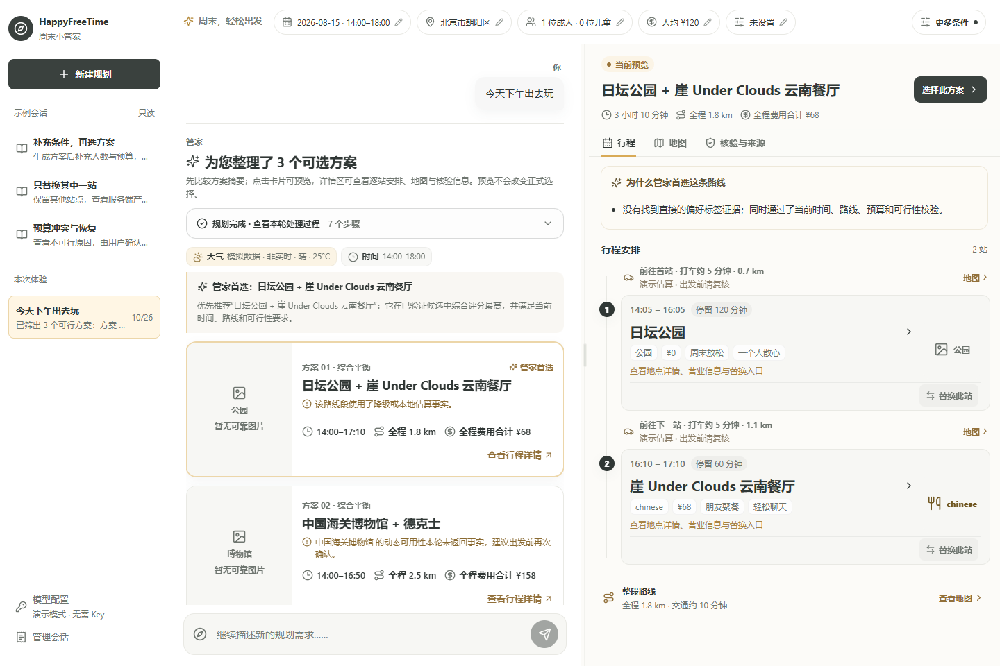
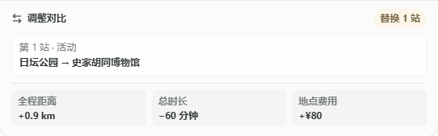
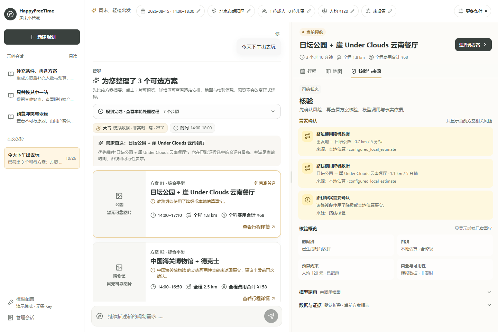
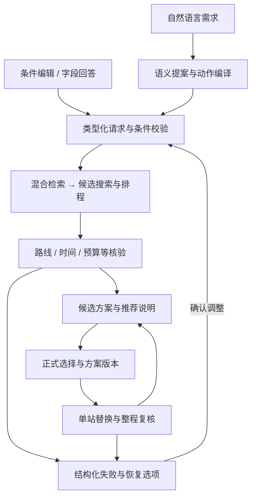

<a id="top"></a>

<div align="center">

<h1>HappyFreeTime · 周末小管家</h1>

<p><strong>把周末想法，变成可比较、可修改、有核验依据的行程。</strong></p>
<p>北京周末出行 · 自然语言规划 · 单站修改 · 约束核验与失败恢复</p>

<p>
  <a href="http://118.25.83.167:8080/"></a>
  <a href="https://github.com/Weekend-Agent-Studio/happyFreeTime"></a>
</p>
<p>
  
  
  
  
  <br />
  
  
  
  
</p>

<p>
  <a href="http://118.25.83.167:8080/">在线体验</a> ·
  <a href="#quick-start">本地运行</a> ·
  <a href="#architecture">系统架构</a> ·
  <a href="#evaluation">评测证据</a> ·
  <a href="docs/learning/planning_flow_guide.md">原架构图与学习导读</a> ·
  <a href="https://github.com/Weekend-Agent-Studio/happyFreeTime/issues">反馈问题</a>
</p>

</div>

> **打开即用，无需登录或 API Key。** 当前为临时 HTTP 演示，支持示例回放和规则规划；公网 HTTP 禁止填写 Key。增强语义体验请在本地或 HTTPS 环境使用自己的 DeepSeek Key。域名与 HTTPS 尚未配置，测试服务可能维护或限流。

<a id="contents"></a>

## 📚 目录

- [项目预览](#overview)
- [三个完整体验场景](#scenarios)
- [核验与可追溯性](#verification)
- [系统架构](#architecture)
- [评测与工程证据](#evaluation)
- [本地运行](#quick-start)
- [Docker 部署与更新](#deployment)
- [当前范围与下一步](#scope)
- [技术栈、仓库结构与文档](#development)

---

<a id="overview"></a>

## 🧭 项目预览

HappyFreeTime 是面向北京周末出行的规划 Agent。从一句需求出发，比较候选方案、查看行程与风险，补充条件后重新规划，或只替换其中一站。



*以下截图来自本地运行的离线 API/SQLite 链路及已有多轮录制示例。商户属性、天气与路线使用演示或估算数据，不是实时商户事实；公网已接入高德的部分会按实际来源另行标记。*

<a id="scenarios"></a>

## 🎬 三个完整体验场景

### 01 · 补充条件，再选方案

“今天下午出去玩” → “改成两个人，人均 150 元，严格控制预算”。

先比较方案的站点、时间、路程与费用，再正式选择。修改条件会让旧方案过期，用户明确重新规划后才更新候选；点击预览不会悄悄替你选定。

### 02 · 只换其中一站

正式选择后，替换活动或餐厅，保留其他站点。系统会重新排程、核验整条路线，并展示替换前后的站点及指标变化；新候选仍需明确选择。



### 03 · 条件冲突时，继续推进

严格预算下没有方案时，先说明当前目录为什么无法满足，再提供可确认的调整方式。确认后仍经过条件校验和重新规划，失败不会覆盖原来的正式方案。


左侧固定的三个多轮示例可直接回看完整过程，也可以用示例需求新建自己的体验。**示例是只读回放，个人体验是实际请求**；刷新后个人历史不恢复，预置示例保留。

<a id="verification"></a>

## 🛡️ 核验与可追溯性

一个好看的地点列表，还需要回答：路上要多久？是否赶得上？预算是否满足？换掉一站后，后面还能接得上吗？

HappyFreeTime 将这些问题纳入同一条规划与修改链路，并在界面上显示已知事实、估算和待确认项。

| 你能观察到的行为 | 对应的工程机制 |
| --- | --- |
| 缺少关键条件时补充信息，明确冲突时给出恢复选项 | 类型化 RequestPatch、ConstraintEngine、Graph interrupt/resume |
| 按偏好寻找地点，再组合与排程 | Catalog 硬过滤、规则/词法/BGE 混合召回、有界 Beam Search |
| 候选方案包含时间、路段、费用和风险提示 | Route / Weather / Availability Provider 与最终 Verifier |
| 只替换目标站点，查看变化后再正式选择 | 版本绑定、非目标站点保留、整程复核、PlanDiff |
| 模型或外部服务失效时仍给出明确结果 | 规则解释、缓存、带来源与原因的降级或结构化失败 |
| 查看本轮实际步骤与模型参与情况 | SSE 阶段事件、run_trace、逐阶段模型调用记录 |

“通过核验”表示通过当前已获得事实与约束的检查，**不等于商家实时营业、库存或出行可执行性的保证**。路线降级时继续展示估算和风险，不把估算写成实时结果。

<details>
<summary>查看核验与来源界面</summary>



</details>

<a id="architecture"></a>

## ⚙️ 系统架构

LLM 用于开放表达理解、受限行程结构提案和推荐解释。类型化编译、候选检索、排程、外部事实、硬约束、版本和副作用边界由确定性代码负责。



推荐解释只引用已返回方案与证据；不合格的模型输出回退为规则解释。自然语言、顶部编辑和字段回答汇入同一套条件引擎，恢复也复用原来的规划器。

原 README 的详细架构图已保留在[主链学习导读](docs/learning/planning_flow_guide.md)，包含三种入口、修改和恢复的阅读路径；模块细节见 [Current 架构](docs/current/resume_v2_architecture.md)。

<a id="evaluation"></a>

## 📊 评测与工程证据

以下摘录自 **S-RX4，2026-10-15，提交 `97474d0`** 的报告。使用固定 Demo World、36 条人工复核任务和 24 条 reviewed 多轮场景；这些是指定版本的工程证据，不是当前公网成功率或延迟承诺。

| 检查内容 | 该次报告结果 | 解释 |
| --- | --- | --- |
| 固定任务：规则结构 + 规则召回 C0 | 34/36 | 作为消融基线 |
| 固定任务：Hybrid C2/C3/C4 | 各 36/36 | 检查召回、结构提案与解释组件的组合 |
| Live 全链路 B3 | 36/36 | 该次真实模型运行结果，可能有波动 |
| reviewed 多轮任务 | 22/23 完成 | 共 24 场景；1 条预期终止不计成功分母，仍有 1 条目录覆盖缺口 |
| 修改与版本保护 | B3 修改链路 10/10；多轮失败修改版本保持 1/1 | 检查修改链路及失败时不覆盖旧版本 |

完整变体、硬约束断言、检索 holdout、失败归因和限制见 [S-RX4 最终回归报告](docs/status/s_rx4_release_20261015.md)。更早的[冻结发布报告](docs/releases/resume_v2_release_report.md)保留自己的版本与口径，不与这里的结果合并。

<a id="quick-start"></a>

## 🚀 本地运行

Windows 快速预览需要 **Python 3.12、Node.js 24 与 pnpm**。尚未安装 pnpm 时可运行 `npm install --global pnpm@11.25.0`，与仓库 Docker 配方保持一致。首次获取代码并安装：

```powershell
git clone https://github.com/Weekend-Agent-Studio/happyFreeTime.git
cd happyFreeTime
py -3.12 -m venv .venv
.\.venv\Scripts\python.exe -m pip install -r requirements.txt
pnpm --dir frontend install --frozen-lockfile
.\scripts\start_local.ps1
```

打开 **http://127.0.0.1:5174/**。最后一条命令会同时启动前后端；默认使用规则与模拟 Provider，无需模型 Key。按 `Ctrl+C` 停止本次服务。依赖已安装时，后续只需运行启动脚本。

<details>
<summary>开发模式、BGE 与高德</summary>

```powershell
# 普通开发模式：API 8000 / 前端 5173，默认离线
.\scripts\start_local.ps1 -Mode Development

# 开发模式显式读取本机模型配置，会产生 API 费用
.\scripts\start_local.ps1 -Mode Development -FullLlm

# 已准备 BGE 资产与高德凭证后，预览完整检索和外部 Provider
.\scripts\start_local.ps1 -HybridRetrieval -LiveAmap
```

BGE 需要额外依赖、模型和索引；高德需要 Web 服务 Key、JS Key 与安全码。先按 [BGE 与高德配置](docs/current/deployment_retrieval.md)准备；`-FullLlm` 的模式与可选依赖见 [启动脚本](scripts/start_backend_demo.ps1)。本地私有配置参考 [.env.example](.env.example)，不要提交凭证。

默认本地公网 Demo 与普通开发模式使用不同端口和数据库。公网 Demo 的 Key 配置仅支持 DeepSeek 官方接口；配置成功不等于已经验证 Key 有效，实际使用情况在每轮核验面板显示。

</details>

<a id="deployment"></a>

## 🐳 Docker 部署与更新

```text
浏览器 → Nginx + React → FastAPI（单 worker）→ SQLite 独立数据卷
                              ├─ 本地 CPU BGE 与索引
                              └─ 可选高德 / 访客自带 DeepSeek Key
```

仓库提供前后端 Dockerfile、Compose、Nginx SSE 转发、健康检查与 HTTPS 模板。默认仅监听服务器本机；启用公网端口、TLS 和外部 Provider 需显式配置。后端不直接映射公网端口。

- [单机部署、HTTPS、更新与回退](docs/current/deployment.md)
- [BGE 资产准备、高德凭证、软件源与冒烟验收](docs/current/deployment_retrieval.md)
- [临时访客身份、Key 保留策略与限流边界](docs/current/public_demo.md)

默认 `rag` 镜像需要先准备模型与索引，模型资产不随 Git 下载。腾讯云容器运行、BGE 预热与召回、高德接入及桌面主流程已完成阶段验收；当前 IP 入口仍是临时 HTTP 测试，HTTPS 和公开容量测试尚未完成。

<a id="scope"></a>

## 📍 当前范围与下一步

- **支持范围：** 北京、受支持的 1–4 站结构；公网无 Key 时自然语言理解使用有限规则。BGE 检索、高德服务与聊天模型分别配置，地图可用不代表所有地点属性已实时核实。
- **数据边界：** POI 价格、营业与可用性仍包含 Demo World 数据；外部查询失败可能使用标明来源的估算。地点图片可能为同类参考，详见界面来源和[截图说明](docs/assets/readme/README.md)。
- **会话边界：** 公网访客与 Key 为临时体验，刷新不恢复个人历史；这不是登录、长期记忆或多实例服务。Key 不写入应用数据库或浏览器持久存储。
- **后续计划：** 完成域名/HTTPS；探索模拟下单闭环、更真实的地点数据及评分偏好。真实预订、支付、叫车、长期记忆和 MCP 运行接入目前均未交付。

<a id="development"></a>

## 🧩 技术栈、仓库结构与文档

| 想了解什么 | 从这里开始 |
| --- | --- |
| 产品定位与真实性原则 | [PRODUCT.md](PRODUCT.md) |
| 完整系统与原架构图 | [主链学习导读](docs/learning/planning_flow_guide.md)、[Current 架构](docs/current/resume_v2_architecture.md) |
| 当前代码入口和能力边界 | [CODEX_BRIEF.md](docs/current/CODEX_BRIEF.md) |
| 文档状态与历史证据 | [文档中心](docs/README.md) |
| 未来设计 | [路线图](docs/canonical/v2_roadmap.md) |

### 技术栈

| 层次 | 技术与职责 |
| --- | --- |
| 规划工作台 | React 19、TypeScript、Vite；候选比较、逐站行程、地图与核验 |
| 请求与工作流 | FastAPI、Pydantic、LangGraph；类型化请求、流式事件、暂停与恢复 |
| 检索与规划 | BGE、规则/词法召回、有界 Beam Search、排程与最终校验 |
| 数据与外部服务 | SQLite / checkpoint、高德 Provider、可复现 Demo World |
| 交付与验证 | Docker Compose、Nginx、pytest、Vitest、Playwright |

### 仓库结构

```text
happyFreeTime/
├── frontend/       React 规划工作台与浏览器测试
├── app/            领域、语义编译、规划、Provider、Graph、API 与持久化
├── data/           演示目录、回放数据与本地检索资产
├── evals/          Frozen / Live、消融与检索评测
├── tests/          后端单元、Graph 与 API 测试
├── deploy/         Dockerfile、Compose、Nginx 与冒烟检查
├── scripts/        本地启动、数据准备与诊断
└── docs/           当前架构、学习导读、评测报告与产品截图
```

### 开发验证

```powershell
.\.venv\Scripts\python.exe -m pytest tests -q
pnpm --dir frontend test
pnpm --dir frontend build
```

真实模型、完整 BGE 评测和外部 Provider 测试需要单独配置；测试结果必须保留对应提交、数据与 Frozen/Live 口径。

---

<p align="center"><a href="#top">↑ 返回顶部</a> · <a href="http://118.25.83.167:8080/">打开演示</a> · <a href="docs/README.md">文档中心</a></p>
