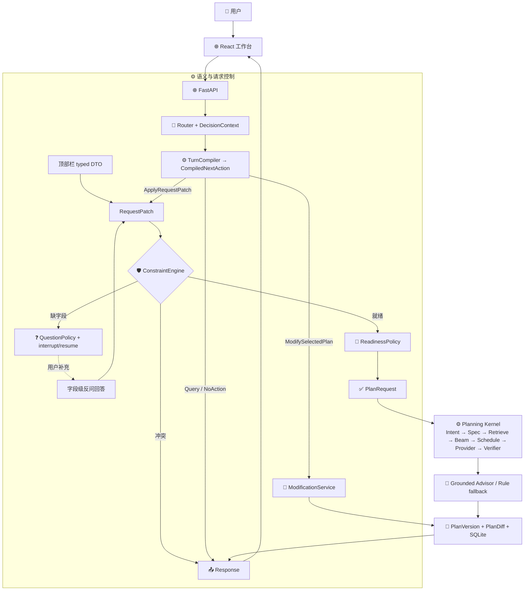

# 从界面操作到规划内核：主链学习导读

_Learning，2026-10-26。保留 main@2016f4c 产品化改写前 README 的架构图与边界说明；当前实现以代码和 [Current 架构](../current/resume_v2_architecture.md) 为准。_

## 原 README 架构图

以下保留原图，供按代码入口学习。图里的 Modify → Persistence 箭头是概览：实际单站修改同样经过替换候选检索、整程排程与 Provider/Verifier 复核；失败可进入类型化恢复。原图把冲突简写为 Response，完整恢复链见下一节。

关键边界：

- 模型不能创建真实 `resource_id`、路线、价格、营业或库存事实。
- `PlanSpecCompiler` 可以拒绝或回退不可执行的结构提案；接受提案不等于方案一定可行，最终仍由 Route/Availability/Verifier 裁决。
- 路线估算用于搜索排序，真实或回放 Provider 用于 finalist 复核；所有最终方案必须通过硬约束验证。
- 模型超时、格式错误、越权输出、无依据解释和不可执行提案都必须进入安全回退或结构化失败。

## 建议按三个入口对照阅读

1. **自然语言规划**：`app/api/planning_turn.py` → `app/orchestration/entry_graph.py` → Router / TurnCompiler。语义提案只有编译成合法动作后才能改变业务状态。
2. **顶部条件编辑与字段反问**：直接产生类型化 `RequestPatch`，经过 `ConstraintEngine`；不为了复用流程重新伪装成自然语言。
3. **正式选择后的单站修改**：携带方案版本和目标站点，保留非目标站点；经 `ModificationWorkflow` 与 `PlanningService.modify_selected_plan` 重排与复核，再生成候选版本和 `PlanDiff`。查看候选与正式选择是不同操作。

## 遇到无方案时怎样继续

`结构化失败证据 → RecoveryReasonAdapter → RecoveryPolicy → 用户确认的类型化 RecoveryAction → ConstraintEngine → 原规划/修改链路`。

恢复复用原有规划器。默认条件的自动调整受现有策略约束，用户明确指定的硬条件不能被模型自行放宽；过期动作、重复提交和错误版本会被拒绝。Graph interrupt/resume 与 SQLite checkpoint 承担暂停和恢复。

## 两种“记录”分别解释什么

- **run_trace / SSE progress**：本轮业务步骤、状态和耗时，包含重试与恢复。阶段总耗时可包含网络、缓存和校验，不等于纯模型时间，也不是模型隐藏思维链。
- **runtime_decisions**：模型是否参与、使用了哪个适配器、耗时与回退；配置了 Key 不等于每个阶段都会调用 LLM。BGE 是本地向量模型，和付费聊天模型分别展示。

开发模式可恢复已持久化会话；公网 Demo 的访客身份仅存在当前页面对应的临时体验中，刷新不恢复个人历史。不要把 SQLite 存在误读为公网账号系统。

## 从哪里继续

- [首页与产品场景](../../README.md)
- [完整 Current 架构](../current/resume_v2_architecture.md)
- [统一领域术语](../../CONTEXT.md)
- [三阶段架构演进](../interview/05_三阶段架构演进_从ReAct原型到受约束规划Agent.md)
- [语义规划与 Hybrid RAG](../interview/06_从关键词匹配到可验证语义规划与轻量RAG.md)
- [Wire Proposal 与 CommandCompiler](../interview/07_从万能Interpretation到受约束WireProposal与CommandCompiler.md)
- [S-CORE3 统一动作链路](../interview/09_S-CORE3从多入口到统一动作链路.md)

以上是学习路径，不替代各次评测所绑定的提交与报告。历史指标保留在原报告中，不随首页文案改写。
